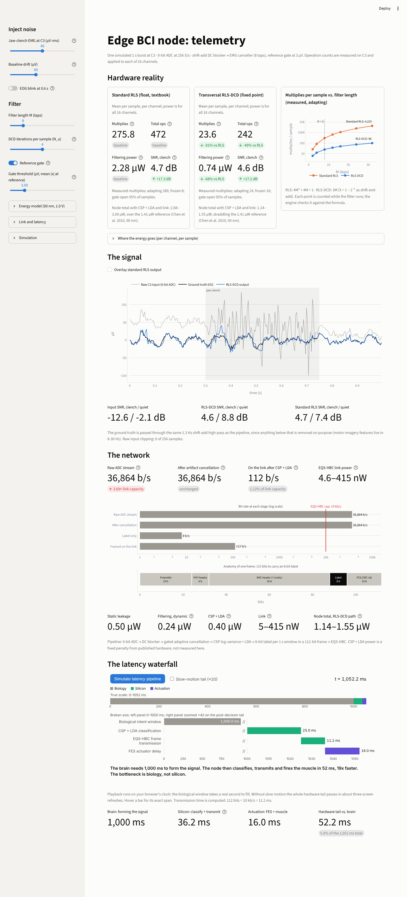

# Edge BCI node: telemetry

An interactive simulation of a low-power, edge-compute brain-computer interface node for stroke rehabilitation. It cleans motor-cortex EEG on the device, classifies motor intent on the device, and sends one short packet per second over an electro-quasistatic human-body-communication (EQS-HBC) link to a functional electrical stimulation (FES) actuator.

Every number on the dashboard comes from the engine as it runs: operation counts are counted while the filters execute, signal quality is scored against a known ground-truth EEG, and bandwidth and latency are arithmetic on the link and frame parameters. Nothing is a placeholder.



## What it shows (default settings)

| Constraint | Result |
|---|---|
| **Compute** | Transversal RLS-DCD needs **24** multiplies per sample (3M at M = 8) against **289** for textbook RLS (4M² + 4M + 1), with nearly the same cleaning quality (4.3 vs 4.7 dB SNR during a jaw clench, from −12.6 dB at the input). |
| **Power** | Filtering power for 16 channels at 90 nm: **0.74 µW** (RLS-DCD) vs **2.36 µW** (RLS). The whole node, including CSP + LDA and the radio, uses **1.14–1.55 µW**. |
| **Bandwidth** | Raw EEG at 16 ch × 256 S/s × 9 b = **36,864 b/s**, 3.7× the 10 kb/s EQS-HBC cap. Cleaning does not compress. On-node CSP + LDA sends one 8-bit label per second in a 112-bit IEEE 802.15.6-style frame: **112 b/s**. |
| **Latency** | The brain needs **1,000 ms** to form the signal. Classification (25 ms), transmission (11.2 ms) and FES actuation (16 ms) take **52 ms** in total. |

## How it works

`bci_core.py` is the engine; `app.py` is the Streamlit dashboard.

1. **Signal model.** 1 s at C3: 1/f background, mu (10 Hz) and beta (21 Hz) rhythms with a drop in power at motor-imagery onset, jaw-clench EMG (20–100 Hz) through an unknown 5-tap path, electrode drift, optional blinks. Digitised by a 9-bit ADC.
2. **Drift removal.** Two cascaded DC blockers built only from shifts and adds (≈1.3 Hz cut-off).
3. **Artifact cancellation.** Reference electrodes on the masseter (EMG) and forehead (EOG) drive adaptive noise cancellers: textbook RLS (float64) or transversal RLS-DCD (Zakharov, White & Liu, *IEEE Trans. Signal Process.* 2008) in int64 fixed point. In the DCD solver, every power-of-two multiplication is a literal `>>`.
4. **Reference gate.** Each canceller adapts only while its reference carries signal. Without the gate, a silent reference makes the filter fit the EEG with noise and damages the output.
5. **Counting.** Every arithmetic line goes through a counter. `python bci_core.py` checks the measured multiplies against the closed forms for M = 2…32.
6. **Power.** Measured ops × energy per op (90 nm: 1.5 pJ per multiply, 0.1 pJ per add, shift or compare) × 256 S/s × 16 channels, plus 0.5 µW static leakage, plus a fixed CSP + LDA penalty, plus the link.

## Assumptions and limits

- This is a simulation, not measured silicon. Operation counts are exact for this code; energy per operation is a fixed approximation that ignores operand width. Charging float64 RLS at integer-multiply energy flatters the RLS baseline.
- Operation counts are measured on one channel and applied to all 16.
- CSP + LDA power is a fixed 0.4 µW penalty from published low-power implementations. A streaming arithmetic-only estimate with the same energy model is 0.07 µW; the difference is memory, control and clocking. The classifier itself is not trained here: only its output format (one 8-bit label per window) enters the bandwidth and latency model.
- The 112-bit frame uses the 802.15.6 MAC header (7 octets) and a 16-bit FCS, plus a 24-bit preamble and 8-bit PHY header assumed for the custom EQS-HBC radio. The standard's own HBC PHY uses a much longer preamble.
- The 415 nW link power is the radio's rating at its full 10 kb/s, so the link term is shown as a range.
- The 25 ms classification time assumes batch processing at window close. Accumulating features sample by sample would cut it below 1 ms.
- When a canceller is frozen, RLS-DCD still updates one column of its correlation matrix (2M multiplies, against M for frozen RLS). A production design could pause that update and rebuild it on wake-up.
- ADC full scale (±400 µV) and the 16 ms FES delay are assumptions.

## Run locally

```bash
pip install -r requirements.txt
streamlit run app.py          # dashboard
python bci_core.py --plot     # engine self-checks + phase1_check.png

# documentary motion graphics (needs manim + Source Sans 3 / Source Code Pro)
cd motion && manim -r 1920,1080 --fps 24 -a bdn04_motion.py

# the cinematic explainer: chapters two at a time, then score + -14 LUFS mix + mux
cd motion && ./render_chapters.sh -qh -r 1920,1080 --fps 24 && python build_film.py
# (or the whole film in one pass, picture only: manim -qh -r 1920,1080 --fps 24 explainer.py MasterExplainer)
```

Tested on Python 3.13. Every pinned package also ships wheels for Python 3.12.
